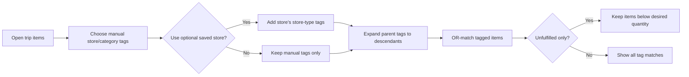
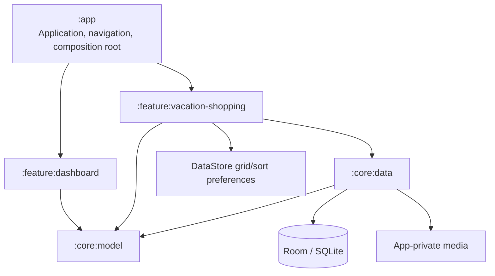

# Feature: Vacation Shopping Hub
Date: 2026-09-05

## Requirements
* Deliver Riceball, an Android 15+ phone app in English and portrait orientation, with a life-assistant dashboard that shows installed modules and a complete Vacation Shopping module.
* Use original bundled artwork modeled on the 🍙 onigiri emoji for the launcher icon and in-app mark, with a monochrome visual theme. Do not depend on the device's emoji font, so the identity remains consistent across devices.
* Work fully offline on one device with no account, cloud service, backup, or network dependency.
* Show only installed, code-defined modules on the dashboard. The first release shows Vacation Shopping only and has no dashboard edit mode or placeholder cards.
* Let the user create, edit, archive, restore, and search vacation trips. A trip requires a name and one currency.
* Open a trip on a metrics-first overview showing total receipt spend, the top two named purchase types by split amount, uncategorized spend, a horizontal spending-by-type chart, three recent item-filter combinations, a pending-receipt count, and an unfiltered item-grid action.
* Make total-spend interactions open all receipts and purchase-type metrics open receipts filtered by that type. Recent-filter interactions open the photo grid with those filters; the item-grid action opens it unfiltered.
* Let the user create a wanted item from the camera or one or more gallery images. Each item requires one primary photo and may have additional photos, an optional name, optional notes, a required positive desired quantity defaulting to 10, store-type tags, and item-category tags.
* Treat every image in a multi-image gallery selection as a separate item draft by default.
* While editing a draft, let the user consume any other queued drafts as additional photos of the current item, choose the primary photo, crop and reorder the merged photos, and continue with the shortened queue.
* Review drafts in a swipeable queue with optional batch application of desired quantity and tags. Confirmed items save immediately; retained unfinished drafts stay hidden and can be resumed, discarded, or bypassed when "Add items" is used again.
* Offer an optional square crop with rotate and reset controls for every wanted-item photo, whether imported or captured. One source image produces at most one item photo.
* Copy imported and captured media into app-private storage so records do not depend on continued gallery access. When the user applies a crop, retain only the normalized cropped result to save storage. Normalize saved item and receipt images to a maximum 2560-pixel longest edge at approximately 90% JPEG/WebP quality.
* Keep store-type tags and item-category tags separate. Both are user-created parent/child hierarchies.
* When filtering by a parent tag, match items tagged with that parent or any descendant. A child selection does not match its ancestors or siblings.
* Combine selected store-type and category tags with OR. Apply purchase status, including "unfulfilled only," as a separate narrowing constraint.
* Apply filters live with visible chips and result count. Record a distinct, non-empty combination in per-trip recent history only when the filter panel closes and the combination produced at least one result. Reusing it moves it to the top; retain three.
* Let the user save stores within a trip with a required name, optional branch/location notes, and store-type tags.
* Make manual store-type tags the primary filtering control. Optionally let the user select a saved store as a shortcut that adds its store-type tags to the manual selections; no saved store is selected by default.
* Let the user record price sightings for an item at a saved store with a package price, package quantity, observation date, and optional notes. Derive a comparable per-item price when package quantity is valid.
* Let the user record one or more purchases against an item. Quantity is required; store, date, total paid, and receipt link are optional.
* Provide a quick-purchase stepper on item cards. During one foreground app session, repeated increments update one unassigned quick purchase per item; decrement affects only that quick purchase. Opening details or backgrounding the app finalizes it.
* Support partial fulfillment and purchases across multiple stores or dates. An item is complete when total purchased quantity is at least the desired quantity. Preserve and display overages.
* Under "unfulfilled only," keep an item that has just become complete visible until the user refreshes or leaves the grid.
* Let the user choose one through five photo-grid columns. Persist the selected density globally across trips.
* Let the user sort items by name, remaining quantity, or most recent item activity, in either direction. Item activity includes creation, edit, price sighting, or purchase. Persist the sort field and direction globally; unnamed items follow named items in both name directions.
* Let the user create a receipt directly under a vacation trip. A receipt requires one primary photo and may have additional photos; store, date, total, and purchase-type splits are optional.
* Save a receipt immediately after its first photo. Add optional metadata and pages afterward. A receipt without a total is pending and contributes to the trip overview's pending count.
* Keep receipt purchase-type tags as a separate, user-managed flat set.
* Treat purchase-type splits as authoritative for grouped category summaries when present. When their sum differs from the optional receipt total, show a warning and retain both values. Item-level purchase amounts are informational and need not reconcile to either value.
* Show trip receipt totals grouped by purchase-type tag. Show amounts without a purchase type as "Uncategorized," and separately show the count of receipts that cannot contribute because they have no amount.
* Allow active and archived trips to retain all items, purchases, sightings, stores, receipts, tags, and photos. Allow permanent trip deletion only from archives after impact confirmation.
* Archive wanted items by default. Allow permanent item deletion only from an archived-items view after impact confirmation; retain receipts while removing links to deleted purchases.
* Rely on the device lock and Android app-private storage rather than adding an app-specific PIN or biometric lock.
* Meet the primary acceptance outcome entirely offline: create a trip, import photo items, tag and filter them for a store, record partial purchases, attach receipts with optional typed splits, and view unfulfilled items and receipt totals by purchase type.

## Scope
### In scope
* Native Android application for Android 15 and newer.
* Installed-module dashboard shell.
* Trip creation, editing, archive/restore, and search.
* Trip metrics overview and receipt drill-downs.
* Photo-first wanted-item management, one-draft-per-image intake with optional draft merging, resumable drafts, and item archive/restore.
* Hierarchical store-type and item-category tag management.
* Manual store-type filtering with optional saved-store augmentation.
* Price sightings and derived comparable prices.
* Partial purchases, fulfillment status, and overage tracking.
* Multi-photo receipts, optional metadata, flat purchase-type tags, and grouped trip totals.
* Immediate receipt capture and pending evening-review workflow.
* Empty, loading, validation, media-import failure, and destructive-action confirmation states.
* Local Room persistence, DataStore grid/sort preferences, and app-private media files.

### Out of scope
* Accounts, authentication, cloud sync, cloud backup, manual export/import, or multi-device access.
* Network-required behavior.
* Automatic store detection, maps, geofencing, or location permissions.
* Built-in country tax-exemption rules, customs calculations, exchange-rate conversion, or legal/tax advice.
* Android Share-sheet ingestion.
* Multiple wanted items or multiple item-photo crops extracted from one source image.
* Tablet or foldable adaptive layouts.
* iPhone implementation.
* Multiple currencies within one trip.
* Exact reconciliation between receipt totals, receipt splits, and linked item purchases.

### Deferred
* Native iPhone app, with shared Kotlin domain/data code considered when iPhone work is committed.
* On-device product-photo OCR and translation.
* Receipt OCR after connectivity becomes available, followed by a confirmation view with extracted values above the original receipt image. The OCR provider, privacy policy, retry behavior, and confidence model require a separate design.
* Cloud backup/sync and conflict resolution.
* Copying or reusing wanted items across trips.
* Country-specific tax-exemption and customs workflows.
* Android Share-sheet ingestion.

## Assumptions / Conditions
* **Confirmed:** The repository is an empty Git repository, so this feature establishes the initial Android project and conventions.
* **Confirmed:** The app display name is Riceball and its temporary local-development application ID is `app.riceball.lifeassistant`.
* **Confirmed:** Initial distribution is a locally installable debug APK, not an app-store or third-party distribution build.
* **Confirmed:** Android is delivered first; a later iPhone app should not force premature cross-platform UI or storage complexity.
* **Confirmed:** The app uses Kotlin and Jetpack Compose, Room for relational app data, and DataStore for global grid-density and sort preferences.
* **Confirmed:** Dependencies use explicit constructor-based wiring. Adopt a dependency-injection framework only when manual composition becomes hard to navigate or several functional modules share scoped dependencies.
* **Confirmed:** The first release is single-user, local-only, English-only, Android 15+, and phone portrait-only.
* **Confirmed:** A wanted item belongs to exactly one trip.
* **Confirmed:** Wanted items use archive as the normal removal action; permanent deletion is isolated in the archived-items view.
* **Confirmed:** Desired quantity cannot be blank or unlimited, defaults to 10, and may be exceeded.
* **Confirmed:** Wanted-item cropping is optional and square-only. The app retains only the cropped result, so an applied crop cannot be changed back to content outside its saved bounds.
* **Confirmed:** Saved item and receipt photos are capped at a 2560-pixel longest edge and encoded at approximately 90% quality.
* **Confirmed:** Receipt records may be photo-only. All extracted or typed monetary fields are optional.
* **Constraint:** A trip has one currency. Every monetary amount under that trip uses it.
* **Constraint:** Imported images are copied into app-private storage and are lost if the app is uninstalled or app data is cleared.
* **Condition:** The plan must not represent grouped receipt totals as complete spending totals when one or more receipts have no amount.

## User workflows
### Open the life-assistant dashboard
1. The user opens the app and sees cards for installed modules.
2. In the first release, Vacation Shopping is the only card.
3. Selecting Vacation Shopping opens the trip list.
4. New module cards appear only when future code adds those modules; users do not create, rename, reorder, show, or hide module cards.

### Create and populate a vacation trip
1. The user creates a trip with a name and currency.
2. The user opens the trip and creates a wanted item.
3. The user takes a photo or selects one or more gallery images.
4. For each wanted-item photo, the user may accept the full image or adjust a square crop, rotate it, and reset the crop before confirming.
5. The app normalizes the confirmed image, copies the result into private storage, discards any temporary source copy, and marks one image as primary.
6. The user optionally adds a name and notes, changes the default desired quantity of 10, and applies store-type and category tags.
7. The item appears in the trip list with purchased and desired quantities.

### Review a trip overview
1. The user opens a trip and lands on its overview.
2. "Spent so far" sums only present receipt totals; receipts without totals increase the pending count instead.
3. The top two named purchase-type metrics and horizontal bar chart use receipt split amounts. Uncategorized appears separately and in the chart, but not in the top two.
4. Tapping total spend opens all receipts. Tapping a named metric, chart bar, or Uncategorized opens the corresponding filtered receipt list.
5. The overview shows the three most recently applied distinct item-filter combinations.
6. Tapping a recent filter opens the photo grid with it restored; tapping "View all items" opens the grid unfiltered.

### Import multiple wanted-item images
1. After selecting multiple gallery images, Riceball creates one item draft per source image and opens a swipeable queue.
2. While editing the current draft, the user may choose "Attach other queued photos."
3. The user selects any other queued drafts to consume into the current item. Those drafts leave the queue and their images become additional photos.
4. After merging, the user immediately chooses the primary photo, then may crop and reorder each photo.
5. The user edits the item and may apply desired quantity or tags to all remaining drafts.
6. Confirming the current draft creates a normal item immediately.
7. If the user exits early, confirmed items remain and Riceball asks whether to discard or retain unfinished drafts.
8. Retained drafts remain hidden from item lists. The next "Add items" action offers Resume drafts, Discard drafts, or Start a new import.

### Find relevant items in a store
1. The user opens the trip's item list.
2. The user manually selects store-type and category tags. No saved store is required or selected by default.
3. The user may optionally select a saved store, whose store-type tags are added to the manual store-type selections.
4. The app expands selected parent tags to their descendants.
5. Items matching any selected tag are shown.
6. If "unfulfilled only" is enabled, completed items are removed from those tag matches.
7. Filter changes update chips and result count immediately.
8. Closing the panel records the non-empty combination only if it produced a result; duplicates move to the top.
9. The user clears filters to return to the full list.

### Record a price sighting
1. The user opens an item and chooses to add a sighting.
2. The user selects or creates a saved store.
3. The user enters the displayed package price and package quantity, plus optional date and notes.
4. The app shows the derived per-item price while retaining the original package values.
5. Invalid or zero package quantities produce inline validation and are not saved.

### Record purchases and fulfillment
1. The user increments or decrements the quick-purchase stepper on an item card.
2. Plus creates or increments one unassigned quick purchase for that item in the current foreground session. Minus can reduce only that record and cannot reduce below zero.
3. Opening details lets the user add a store, date, total paid, or receipt and finalizes the quick purchase.
4. Backgrounding or closing Riceball finalizes remaining quick purchases without optional details. Startup finalizes any stale quick record left by process death.
5. The item shows purchased, remaining, complete, and overage quantities.
6. A newly completed item stays visible in the current unfulfilled view until refresh or navigation.
7. Older purchases are edited or deleted from history, which recalculates fulfillment immediately.

### Capture and summarize receipts
1. The user adds a receipt to a trip from the camera or gallery.
2. Riceball copies the first photo and immediately saves a photo-only receipt.
3. The user may leave at once or open receipt detail to add pages, store, date, total, splits, notes, and links to recent unlinked purchases.
4. A receipt without a total remains pending.
5. From the trip overview, the user opens pending receipts newest-first for later review.
6. Saving a total removes a receipt from pending even if other optional fields remain blank.
7. The summary groups split amounts by purchase type, assigns untyped splits and positive total remainder to Uncategorized, and shows receipts with no totals.
8. The user can drill into summary contributions to inspect filtered receipt photos and details.

### Archive and restore a trip
1. The user archives a trip after confirmation.
2. The trip disappears from the active list but remains in archived search.
3. Restoring returns it to the active list with all related data and media intact.
4. Permanent deletion is available only in archives and confirms the counts of records and photos to erase.

### Archive and delete a wanted item
1. Removing an active wanted item archives it, preserving photos, sightings, purchases, and receipt links.
2. The archived-items view allows restore.
3. Permanent deletion is available only there and shows an impact confirmation.
4. Permanent deletion removes item photos, sightings, and purchases. Receipts remain, but links to removed purchases are cleared.

## High Level Design
### Architecture
Use a small Gradle multi-module Android build:

The app uses unidirectional data flow with Compose screens, screen-level ViewModels, immutable UI state, and repository interfaces. Domain models and rules remain Android-light where practical, while Room entities, Android URI handling, camera/gallery contracts, and DataStore stay in Android-specific modules. This creates a clean seam for later Kotlin Multiplatform evaluation without constraining the first release to shared persistence or UI.

No network client is included. All normal workflows read and write local state. Media file writes and database records use a staged operation: copy to a temporary private file, validate it, apply the confirmed item-photo crop and orientation when applicable, atomically move only the normalized result to its final path, then commit the database reference. On success or failure, remove the temporary source file. On failure, surface a retryable error.

### Components
#### `:app`
* **Responsibilities:** Android application, theme, top-level navigation, manual dependency composition, and lifecycle integration.
* **Changes:** New Android project and Gradle configuration targeting Android 15+.
* **Interfaces:** Supplies repositories and media services to feature navigation graphs.
* **Failure behavior:** A fatal database-open or migration failure shows a blocking recovery screen; it must not silently reset user data.

#### `:core:model`
* **Responsibilities:** Immutable trip, item, tag, store, sighting, purchase, receipt, split, and summary models; identifiers; validation; fulfillment and filter rules.
* **Changes:** Define domain contracts without Compose, Room, or Android media types.
* **Interfaces:** Repository contracts expose Kotlin `Flow` for observed state and suspending mutation functions with explicit results.
* **Failure behavior:** Reject invalid quantities, cycles, cross-trip links, and mismatched tag kinds before persistence.

#### `:core:data`
* **Responsibilities:** Room database, entities and relations, migrations, repository implementations, transactions, app-private media management, and DataStore-backed global grid/sort preferences.
* **Changes:** Create the initial schema and media directory layout.
* **Interfaces:** Implements domain repositories and media import/delete operations.
* **Failure behavior:** Database mutations that affect multiple records are transactional. Failed media imports leave no referenced partial files. Failed deletion is surfaced and queued for safe retry rather than reported as successful.

#### `:feature:dashboard`
* **Responsibilities:** Render installed module cards and navigate into available modules.
* **Changes:** Add a fixed dashboard containing Vacation Shopping.
* **Interfaces:** Reads the app's installed module registry.
* **Failure behavior:** If no module can load, show a visible error and retry action.

#### `:feature:vacation-shopping`
* **Responsibilities:** Trips, hierarchical tags, stores, photo items, filters, sightings, purchases, receipts, and summaries.
* **Changes:** Add Compose navigation destinations and ViewModels for each workflow.
* **Interfaces:** Uses domain repository contracts and Android activity-result contracts for camera and gallery.
* **Failure behavior:** Forms retain user-entered state after validation or persistence failure. Empty states provide the relevant create action. Long media operations show progress and can be cancelled before commit.

### Data design
Use UUID identifiers generated in the app. Persist timestamps as UTC instants and format them locally in the UI.

* `Trip`: `id`, `name`, `currencyCode`, `status` (`ACTIVE` or `ARCHIVED`), `createdAt`, `updatedAt`.
* `WantedItem`: `id`, `tripId`, optional `name`, optional `notes`, `desiredQuantity`, `status` (`ACTIVE` or `ARCHIVED`), `createdAt`, `updatedAt`.
* `MediaAsset`: `id`, `ownerType`, `ownerId`, private relative path, MIME type, ordinal, `isPrimary`, created timestamp. Database constraints enforce exactly one primary asset per item or receipt at completed-save time.
* `ItemImportBatch`: `id`, `tripId`, status, created and updated timestamps.
* `ItemImportDraft`: `id`, `batchId`, temporary media path, queue ordinal, draft fields, and draft tag assignments. Confirming converts a draft into an item; discarding removes its temporary media.
* `Tag`: `id`, `kind` (`STORE_TYPE`, `ITEM_CATEGORY`, or `RECEIPT_PURCHASE_TYPE`), `name`, optional `parentId`, timestamps. Receipt-purchase-type tags must have no parent.
* `ItemTag`: `itemId`, `tagId`. Only store-type and item-category tags are valid.
* `Store`: `id`, `tripId`, `name`, optional `branchLocationNotes`, timestamps.
* `StoreTypeTag`: `storeId`, `tagId`. Only store-type tags are valid.
* `PriceSighting`: `id`, `itemId`, `storeId`, `packagePriceMinor`, `packageQuantity`, optional `observedAt`, optional `notes`, timestamps.
* `Purchase`: `id`, `itemId`, optional `storeId`, optional `receiptId`, `quantity`, optional `totalPaidMinor`, optional `purchasedAt`, optional quick-capture session ID, status (`QUICK` or `FINAL`), timestamps.
* `Receipt`: `id`, `tripId`, optional `storeId`, optional `receiptTotalMinor`, optional `purchasedAt`, optional `notes`, timestamps.
* `ReceiptSplit`: `id`, `receiptId`, optional `purchaseTypeTagId`, `amountMinor`, optional `notes`.
* `RecentItemFilter`: `id`, `tripId`, normalized serialized filter criteria, display label, result count, and `lastUsedAt`. Retain at most three distinct successful combinations per trip.
* `ItemGridPreference`: stored in DataStore as global column count (`1..5`), sort field (`NAME`, `REMAINING`, or `RECENT_ACTIVITY`), and sort direction.

Money uses integer minor units plus the trip's ISO 4217 currency code; currencies with nonstandard minor units use platform currency metadata. A trip currency cannot change after any monetary amount exists unless a future explicit conversion workflow is designed.

Tag trees use adjacency-list parent identifiers. Mutations reject self-parenting, cross-kind parents, and cycles. Descendant queries use a recursive Room query or a transactionally maintained closure table; prototype both against representative tree depth and choose the simpler implementation that passes correctness tests. The expected dataset is small enough that either is viable.

Deleting a parent tag requires selecting a replacement parent for its direct children. The replacement may be another valid tag of the same kind or root. The deleted tag's direct assignments are removed; child tags and their assignments remain intact under the selected replacement.

Relations enforce trip boundaries: items, stores, receipts, purchases, and sightings cannot be linked across trips. Room foreign keys and repository validation both protect these invariants. Deleting a parent record requires confirmation and uses explicit transactional cascades. Media files are removed only after the database transaction identifies assets no longer referenced; failed file cleanup is recoverable.

Quick purchases persist on every step. Backgrounding finalizes all `QUICK` purchases from the foreground session. Startup finalizes stale quick records left by process death before accepting new quick input; zero-quantity quick records are deleted.

Receipt summary semantics:
* Overall "Spent so far" is the sum of present receipt totals only.
* A receipt split contributes its amount to its selected purchase type or "Uncategorized."
* If a receipt has a total greater than the sum of its splits, the remainder contributes to "Uncategorized."
* If splits exceed a present receipt total, show a data-quality warning and use the split amounts in grouped totals.
* A receipt with no total and no splits contributes no money and increments the missing-amount count.
* A receipt with splits but no total contributes its split amounts and is marked "total not confirmed."
* Uncategorized participates in the chart but not the top-two named purchase-type metrics.

### API and interface design
There is no remote API in the first release. Internal repository contracts form the stable boundary:

* `TripRepository`: observe active/archived trips; create, edit, archive, restore, and delete trips.
* `ItemRepository`: observe active/archived filtered items; create, edit, archive, restore, and permanently delete archived items; observe fulfillment derived from purchases.
* `ItemImportRepository`: create one draft per selected image, merge selected queued drafts into the current item, persist and resume draft queues, apply shared defaults, confirm drafts into items, and discard temporary drafts.
* `TagRepository`: manage separate tag kinds; move tags; reject cycles; resolve descendant identifiers.
* `StoreRepository`: manage trip stores and store-type assignments.
* `PriceSightingRepository`: manage item sightings and derived display values.
* `PurchaseRepository`: manage purchases and receipt links transactionally.
* `ReceiptRepository`: manage receipts, photos, optional splits, and summary projections.
* `MediaRepository`: stage camera/gallery content in private storage, create a normalized square cropped item-photo result when requested, open content streams, reorder photos, select a primary photo, and delete temporary or unreferenced assets.
* `ItemGridPreferenceRepository`: observe and update global item-grid density and sorting preferences.
* `RecentFilterRepository`: record successful distinct combinations, enforce a three-entry per-trip limit, and restore criteria.

All create and update contracts validate required fields and trip ownership. UI errors distinguish invalid input, missing media, unavailable source content, storage exhaustion, permission/camera cancellation, and persistence failure. Repeated save taps are disabled while a mutation is in flight; repository creates accept caller-generated UUIDs so retries are idempotent.

The item list exposes a single filter state containing manually selected store-type IDs, selected category IDs, optional saved store ID, and fulfillment status. A selected saved store adds its store-type IDs to the manual selections. Tag matching is OR across all expanded tag IDs. Fulfillment status is applied with AND after tag matching.

The grid exposes a separate global display preference with one through five columns and a sort specification. Recent activity is the maximum timestamp across item creation/update, sightings, and purchases. Name sorting always places unnamed items after named items, independent of direction.

The trip overview exposes separate projections for receipt-total spend, split-derived spending by purchase type, uncategorized spend, pending receipt count, and recent item filters. Keeping them separate prevents a split/total mismatch from being hidden behind one ambiguous spending value.

### UI states
* Dashboard: loading, installed module cards, and module-load error.
* Trip list: active, archived, search results, no trips, and no search matches.
* Trip overview: no spend, partial receipt data, pending receipts, top tags, uncategorized spend, chart, recent filters, and no recent filters.
* Item list: all items, filtered results, no items, no matches, unfulfilled-only, delayed removal of newly completed items, one-through-five-column density, all sort modes, and complete/overage indicators.
* Import queue: one draft per source image, queued-draft selection and merging, primary-photo choice, per-photo crop/reorder, shared defaults, retained drafts, and resume/discard/start-new choice.
* Forms: pristine, dirty, validating, saving, save failed, media copying, and cancellation.
* Receipts: just captured, pending review, photo-only, partially categorized, fully categorized, total not confirmed, and inconsistent split warning.
* Archives: active item archive, item restore, archived-item permanent deletion, trip restore, and archived-trip permanent deletion.
* Destructive actions: confirmation describes which related records and private media will be removed.

## Security and Privacy
* Store database and copied media in Android app-private storage; do not request broad storage access when the Android Photo Picker can provide selected media.
* Use a scoped camera output URI through `FileProvider`; never expose raw private file paths.
* Validate image MIME type, decode bounds, maximum dimensions, and configurable maximum file size before accepting content. Apply rotation and crop coordinates only after clamping them to decoded image bounds. Re-encode copied images to a maximum 2560-pixel longest edge at approximately 90% JPEG/WebP quality and remove unnecessary metadata, including location EXIF, after orientation and crop normalization.
* Treat gallery files, image metadata, names, notes, store text, and receipt fields as untrusted input. Bound lengths and render them as text without interpreting markup.
* Keep database queries parameterized through Room.
* Do not log image contents, file paths, receipt values, store notes, or other user-entered personal data.
* No network permission is required in the first release. Automated telemetry and crash-report uploads are excluded unless separately approved.
* Device compromise, device backup settings, screenshots, app uninstall, and cleared app data remain outside the app's protection boundary and must be communicated in privacy/help text.

## Scalability and Reliability
* Design for personal-scale data: up to 100 trips, 5,000 wanted items, 10,000 purchases/sightings, 5,000 receipts, 20,000 media assets, and tag trees up to 10 levels deep.
* Paginate or incrementally load image-heavy lists. Use thumbnails for lists and decode full-resolution images only in detail views.
* Generate thumbnails after import and perform image copy, crop, rotation, and normalization off the main thread.
* Add Room indexes for trip ownership, status, tag joins, store joins, receipt date, and purchase item/receipt relationships.
* Use transactions for multi-table writes and `Flow` for consistent reactive projections.
* No retry loop may duplicate a purchase, receipt, or media record.
* Surface low-storage and corrupt-image failures. Preserve existing records if a new media write or database mutation fails.
* Run orphan-media cleanup at safe app startup intervals, restricted to the app-owned media directory and files not referenced by the database.

## Observability and Operations
* Use structured local diagnostic logging for navigation-independent failures such as database errors, media import failures, and orphan cleanup, without personal or financial fields.
* Provide a local diagnostics screen or debug-only log export only if debugging proves necessary; it is not required for the first release.
* Track debug-build counters for import duration, thumbnail generation failures, query duration, and orphan cleanup results during development.
* Production analytics, remote logging, crash reporting, dashboards, alerts, and on-call procedures are out of scope because the app has no backend or approved telemetry.

## Test Strategy
* **Unit:** Quantity validation, completion/remaining/overage calculations, money formatting, price-per-item derivation, tag-cycle prevention, descendant expansion, OR tag matching plus status narrowing, recent-filter normalization/deduplication, quick-purchase session rules, receipt overview/summary semantics, top-two ranking, and crop-bound clamping and square-output calculations across image orientations.
* **Integration:** Room CRUD and migrations, foreign keys, cross-trip rejection, multi-record transactions, recursive tag queries, tag deletion with parent replacement, resumable/mergeable import drafts, stale quick-purchase finalization, recent-filter retention, overview projections including splits that exceed receipt totals, DataStore grid/sort preferences, cropped-file output, 2560-pixel normalization, temporary-source cleanup, and media/database consistency under injected failures.
* **End-to-end / acceptance:** Compose UI tests for the installed-module dashboard, trip creation, overview metric drill-downs, one-draft-per-image import and queued-draft merging, primary-photo selection, retained-draft resume/discard/start-new choices, accepting an uncropped image, square cropping and rotating each item photo, the desired-quantity stepper, one-through-five-column density, reversible item sorting, live hierarchical filtering and recent-filter restoration, no saved store, optional saved-store augmentation, quick partial purchases, delayed completed-item removal, overage, immediate photo-only receipt save, pending evening review, optional splits, grouped totals, missing-amount warnings, item archive/permanent deletion, and trip archive/restore/permanent deletion.
* **Performance / resilience:** Scroll representative image-heavy lists, import and crop multiple large photos, merge draft photos, query maximum representative data, simulate storage exhaustion, process death during staged media import/cropping or quick purchase, rapid stepper input, and repeated save taps.
* **Security:** Confirm private file locations, Photo Picker use without broad storage permission, `FileProvider` scoping, EXIF location removal, text length limits, and absence of sensitive log content.
* **Migration / rollback:** Start with schema version 1 migration tests and export schema JSON for future migration verification. Confirm failed migrations do not destructively recreate the database.

## Deployment and Rollback
1. Establish application identity, signing configuration, and Android 15+ build settings.
2. Build and install a debug artifact on an Android 15 emulator and at least one physical phone.
3. Run automated unit, Room integration, and Compose acceptance tests.
4. Exercise camera, gallery, low-storage, process-death, archive/restore, and uninstall data-loss behavior manually.
5. Produce a locally installable debug APK and install it on a clean Android 15 device or emulator.

* **Feature flag / rollout:** No remote feature-flag service. The dashboard derives cards from the installed module registry. The first delivery is a local debug APK; any broader distribution requires a separate signing and release-readiness decision.
* **Migration ordering:** Ship Room schema version 1 and exported schema with the first artifact. Future releases must add forward migrations before schema changes.
* **Backward compatibility:** Android 15 is the minimum supported platform. Persist stable IDs and enum storage values rather than display labels.
* **Rollback:** The first release has no older production schema to restore. After release, do not downgrade the database destructively; roll forward with a corrective build. Users must be warned that uninstalling loses all local data.
* **Post-deployment verification:** Create and archive a trip, import camera and gallery media, restart offline, filter items, record purchases, create a photo-only receipt and a categorized receipt, and compare displayed totals with entered values.

## Implementation Plan
1. Scaffold the Gradle project with display name Riceball, application ID `app.riceball.lifeassistant`, and modules `:app`, `:core:model`, `:core:data`, `:feature:dashboard`, and `:feature:vacation-shopping`; configure Kotlin, Compose, Android 15 minimum/target settings, lint, unit tests, instrumentation tests, and Room schema export. Verify all modules build with an empty application.
2. Implement `:core:model` identifiers, models, validation, fulfillment calculations, hierarchical matching, receipt summary rules, and repository contracts. Verify pure unit tests cover all boundary and invalid states.
3. Implement Room schema version 1, converters, DAO queries, indexes, transactions, repository adapters, and migration tests in `:core:data`. Verify trip-boundary, hierarchy, cascade, and idempotency invariants.
4. Implement app-private media staging, validation, orientation normalization, 2560-pixel/approximately-90%-quality encoding, metadata stripping, thumbnail generation, and orphan cleanup. Verify injected copy, storage, cancellation, and database failures do not create broken references or delete unrelated files.
5. Implement the `:feature:dashboard` Compose UI from the installed module registry and DataStore-backed global item-grid preferences. Verify Vacation Shopping navigation and persistence of one-through-five-column density, sort field, and sort direction across process restart and trips.
6. Implement trip list, create/edit, active/archive search, restore, permanent-delete confirmation, and the trip overview with receipt-total spend, top two named purchase types, uncategorized amount, horizontal chart, pending count, recent-filter shortcuts, and drill-down navigation. Verify every metric against mixed complete and incomplete receipts.
7. Implement hierarchical tag management for store types and item categories, including move operations, cycle rejection, deletion with required child-parent replacement or root promotion, descendant matching, and flat receipt purchase-type management. Verify hierarchy and kind constraints.
8. Implement wanted-item camera/gallery capture, one draft per selected image, queued-draft merging into additional photos, immediate primary-photo choice, resumable swipeable queues, batch defaults, optional per-photo square crop with rotate/reset, normalized private results, item forms, desired-quantity stepper, item archive/permanent-delete flows, and image-efficient lists. Verify partial queue exit, retained drafts, uncropped acceptance, one crop per source, cancellation, temporary-source cleanup, permissions, large images, and restart persistence.
9. Implement saved stores, store-type assignment, inline and dedicated tag creation, live manual-first filtering, optional saved-store tag augmentation, category filtering, status narrowing, result counts/chips, recent-filter history, global one-through-five-column grid density, and reversible name/remaining/recent-activity sorting. Verify OR tag semantics, descendant expansion, no-store behavior, successful-result history rules, top-three deduplication, unnamed-item placement, sort recency updates, preference persistence, and unfulfilled-only behavior.
10. Implement price sightings and purchase records, including grid quick-purchase stepping, per-session aggregation/finalization, details, package-derived comparison, partial fulfillment, optional monetary/store/date/receipt fields, history editing/deletion, delayed completed-item removal, and overage. Verify process death, backgrounding, rapid taps, and all calculations.
11. Implement immediate first-photo receipt save, additional pages from detail, optional totals/splits/store/date, recent unlinked purchase links, pending-review list/count, grouped summaries, metric/chart drill-downs, missing-amount disclosure, and inconsistency warnings. Verify receipt-total overall spend, split-derived category totals, uncategorized remainder behavior, and valid photo-only receipts.
12. Add original bundled 🍙-style onigiri artwork for the adaptive launcher icon and in-app mark, plus the monochrome Compose theme. Complete accessibility labels, keyboard/focus behavior, content descriptions, error announcements, English string resources, privacy/help text, and portrait-phone polish. Verify icon rendering across Android launcher masks and critical flows with TalkBack and large font settings.
13. Run the targeted and full existing validation suites, inspect lint/debug-build output, test on Android 15 emulator and phone, produce a locally installable debug APK, and update this plan's status, completed work, deviations, and final review outcome.

## Risks and Mitigations
| Risk | Impact | Likelihood | Mitigation |
|---|---|---|---|
| Local-only data is lost on uninstall, clear-data, device loss, or corruption | High | Medium | Make the limitation explicit in onboarding/help and prioritize backup/export as follow-up work. Never destructively reset on database errors. |
| Photo storage grows quickly | High | Medium | Normalize dimensions, generate thumbnails, show storage errors, remove orphaned media, and define representative scale tests. |
| Keeping only the cropped item photo makes discarded image regions unrecoverable | Medium | Medium | Make cropping optional, provide reset before confirmation, preview the final square clearly, and disclose that the original is not retained. |
| Flexible receipt data produces misleading totals | High | Medium | Label receipt totals and split-derived category totals separately, show uncategorized remainder and missing-amount counts, and warn whenever splits disagree with the receipt total. |
| Live filters pollute recent history with intermediate combinations | Medium | Medium | Record only the final non-empty combination when the panel closes and only when it produced a result; deduplicate normalized criteria. |
| Process death strands a quick purchase in an ambiguous state | Medium | Low | Persist each step immediately and finalize stale records on startup before opening a new quick-capture session. |
| Retained or merged import drafts leak hidden temporary media | Medium | Medium | Keep explicit draft ownership, prompt on Add items, delete consumed/discarded sources transactionally, and cover drafts in orphan cleanup. |
| Hierarchical tags create cycles or surprising matches | Medium | Medium | Enforce same-kind acyclic trees and test descendant-only matching with visible filter chips. |
| A later iPhone app cannot directly reuse Android UI and Room implementation | Medium | High | Keep domain contracts and rules Android-light; evaluate Kotlin Multiplatform only when iPhone delivery is committed. |
| Manual dependency wiring becomes unwieldy as hub modules grow | Medium | Medium | Keep one composition root and constructor injection; adopt Hilt or a multiplatform-capable alternative when multiple functional modules share complex scopes. |
| Optional monetary fields make customs/tax summaries incomplete | Medium | High | Display explicit missing-data counts and avoid legal or completeness claims. |
| OCR expectations expand first-release scope | Medium | Medium | Keep both product and receipt OCR deferred behind a separately approved design with privacy and confidence handling. |

## Open Questions
* None.

## Decision Log
| Date | Decision | Rationale |
|---|---|---|
| 2026-09-05 | Build Vacation Shopping as a module in an extensible life-assistant hub. | The shopping workflow is the first use case, but the product should support additional life-assistant modules. |
| 2026-09-05 | Name the app Riceball and use `app.riceball.lifeassistant` as its temporary development application ID. | Establish a friendly product identity while leaving the identifier explicitly replaceable before distribution. |
| 2026-09-05 | Use original bundled artwork modeled on the 🍙 onigiri emoji with a monochrome theme. | Match the requested app icon while avoiding device-dependent emoji rendering and preserving a consistent identity. |
| 2026-09-05 | Deliver native Android first with Kotlin and Jetpack Compose. | Optimize Android 15+ camera, gallery, offline storage, and UI quality without paying premature cross-platform costs. |
| 2026-09-05 | Keep domain/data boundaries suitable for later Kotlin Multiplatform evaluation. | Preserve a credible iPhone path while avoiding shared UI or storage commitments today. |
| 2026-09-05 | Use Room, DataStore, and manual constructor wiring. | Follow Android-native defaults and minimize framework complexity for the first functional module. |
| 2026-09-05 | Work entirely offline and keep data on-device. | Travel connectivity is unreliable and cloud accounts, sync, and backup are explicitly deferred. |
| 2026-09-05 | Require photos for items and receipts while leaving descriptive and receipt fields optional. | Images are the primary language-independent reference, and incomplete capture must remain fast in-store. |
| 2026-09-05 | Offer optional square cropping for wanted-item photos and retain only the confirmed result. | Isolate the product in screenshots and photos while limiting private storage growth; receipts remain uncropped. |
| 2026-09-05 | Normalize saved media to a 2560-pixel longest edge at approximately 90% JPEG/WebP quality. | Preserve readable packaging and receipt detail while bounding local storage use. |
| 2026-09-05 | Use separate hierarchical store-type and category tags with descendant matching. | Support broad store filtering without conflating where an item may be found with what the item is. |
| 2026-09-05 | Require a replacement parent or root promotion when deleting a parent tag. | Preserve child tags and their assignments while removing only the deleted tag's direct assignments. |
| 2026-09-05 | Remove the shopping-trip concept. | Purchases and receipts attach directly to the vacation trip, with optional store and date context. |
| 2026-09-05 | Use receipt splits for grouped category totals when present and warn when they differ from the receipt total. | Preserve the user's category allocations without hiding inconsistent or incomplete receipt data. |
| 2026-09-05 | Defer OCR, translation, tax rules, customs logic, and currency conversion. | These require separate accuracy, privacy, legal, and connectivity decisions beyond the core offline workflow. |
| 2026-09-05 | Deliver the first build as a locally installable debug APK. | Keep initial distribution simple while the product and workflows are still being validated. |
| 2026-09-05 | Show only installed modules and remove dashboard editing and placeholders. | Users cannot add modules without code, so editing code-defined cards creates controls without meaningful user agency. |
| 2026-09-05 | Persist a global one-through-five-column item-grid density and reversible name, remaining, or recent-activity sort. | Let users trade image size for scan density and keep their preferred browsing behavior across trips. |
| 2026-09-05 | Make manual store-type filters primary and saved stores optional additive shortcuts. | Most filtering should not require defining a store, while saved stores can still accelerate repeat visits. |
| 2026-09-05 | Use an editable desired-quantity stepper with a minimum of one. | Support fast single-step changes and direct entry for larger quantities without permitting invalid zero or negative targets. |
| 2026-09-05 | Approve the 18-screen wireframe direction as the UX baseline. | Make golden paths, management screens, empty states, errors, and destructive actions explicit before implementation. |
| 2026-09-05 | Open trips on a metrics-first overview. | Put receipt spending, pending review, recent store-context filters, and unfiltered item access in one place. |
| 2026-09-05 | Create one draft per imported image and allow queued drafts to merge into the item being edited. | Optimize the common separate-item case while preserving multi-photo items without an up-front grouping question. |
| 2026-09-05 | Aggregate grid stepper taps into one per-item quick purchase for the foreground session. | Make in-store quantity capture fast without creating one history record per tap. |
| 2026-09-05 | Save receipts immediately after the first photo and derive pending status from a missing total. | Minimize register-time work and make later evening review discoverable from the trip overview. |
| 2026-09-05 | Archive items before permitting permanent deletion. | Protect purchase history and receipt context from accidental destructive actions. |

## Implementation Status
* **Status:** Proposed
* **Last updated:** 2026-09-05
* **Completed:** Product interview, scope definition, approved 18-screen wireframe direction, architecture proposal, data model, golden and edge-case workflows, risk analysis, test strategy, and implementation sequence.
* **Remaining:** Obtain explicit implementation approval, implement, validate, and complete senior review.
* **Deviations:** None.
